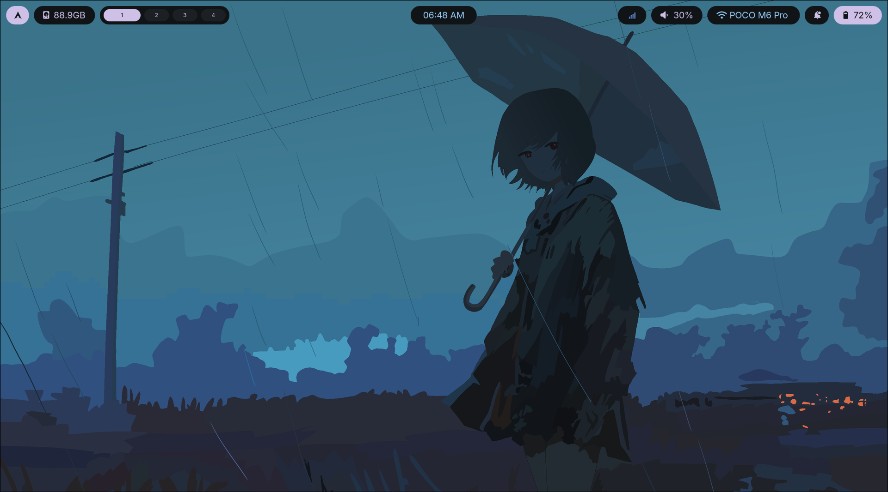
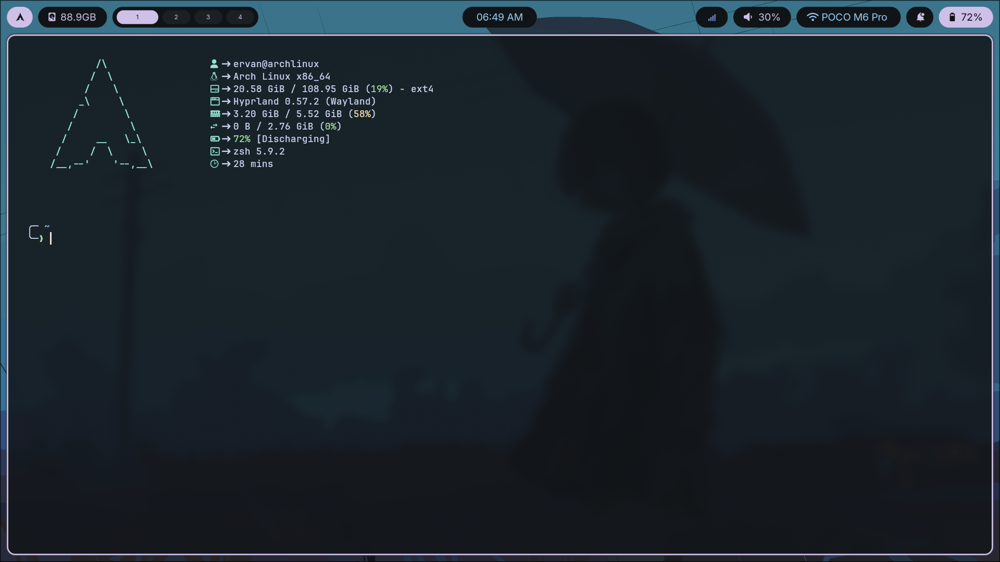
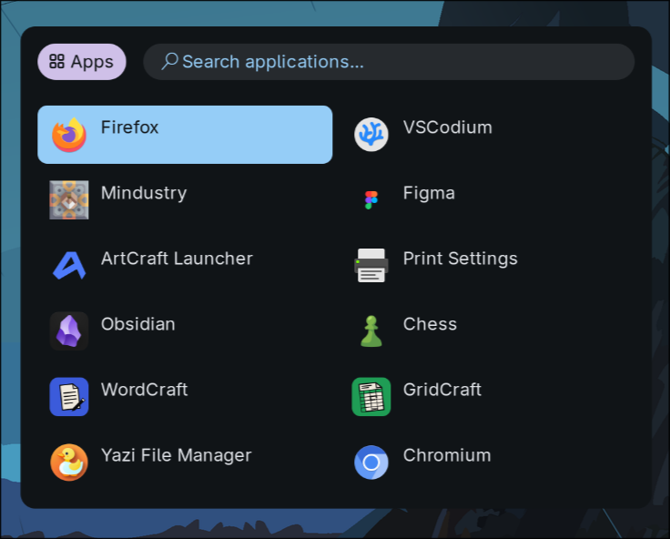
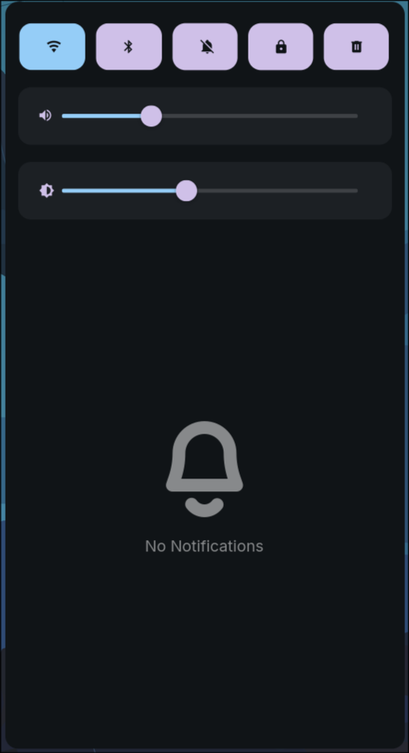

# Hyprland Dotfiles

Personal dotfiles for my Hyprland desktop environment, featuring a customized workflow, carefully configured applications, and a consistent visual theme.

## Preview

<!-- Add screenshots of your desktop here -->

### Desktop
<!-- Screenshot: Desktop -->


### Terminal
<!-- Screenshot: Kitty -->


### Application Launcher
<!-- Screenshot: Rofi -->


### Status Bar
<!-- Screenshot: Waybar -->


### Notifications
<!-- Screenshot: SwayNotificationCenter -->


---

## Environment

| Component | Application |
|---|---|
| Window Manager | Hyprland |
| Terminal | Kitty |
| Shell | Bash |
| Status Bar | Waybar |
| Application Launcher | Rofi |
| Notification Center | SwayNotificationCenter |
| Lock Screen | Hyprlock |
| Idle Manager | Hypridle |
| Logout Menu | Wlogout |
| Color Scheme Generator | Matugen |
| Editor | Neovim |
| System Information | Fastfetch |

---

## Features

- Modular Hyprland configuration written in Lua.
- Dynamic color generation using Matugen.
- Custom Waybar themes and layouts.
- Rofi themes for application launching, window switching, and wallpaper selection.
- Customized Kitty terminal configuration.
- SwayNotificationCenter styling and configuration.
- Hyprlock and Hypridle configuration.
- Wlogout customization.
- Neovim configuration managed with Lazy.nvim.
- Fastfetch configuration with a custom logo.

---

## Directory Structure

```text
~/.config/
├── fastfetch/
├── hypr/
│   ├── modules/
│   ├── colors.lua
│   ├── hypridle.conf
│   ├── hyprland.lua
│   └── hyprlock.conf
├── kitty/
├── matugen/
│   └── templates/
├── nvim/
│   └── lua/
│       └── plugins/
├── rofi/
│   ├── scripts/
│   └── themes/
├── swaync/
│   └── icons/
├── waybar/
│   └── themes/
└── wlogout/
```

---

## Installation

### 1. Clone the repository

```bash
git clone https://github.com/eRv4n/hyprland-dotfiles.git
cd hyprland-dotfiles
```

### 2. Back up your existing configuration

If you already have configurations for these applications, back them up before replacing them.

```bash
mkdir -p ~/.config-backup
cp -r ~/.config/hypr ~/.config-backup/
```

Repeat this for any other configuration directories you intend to replace.

### 3. Install the dotfiles

Copy the configuration directories into `~/.config/`.

> Installation instructions and dependencies will be updated as the configuration evolves.

---

## Configuration

Most configurations are organized into separate directories for easier maintenance and customization.

### Hyprland

The Hyprland configuration is divided into modules for specific settings and functionality.

- `hyprland.lua` — Main configuration entry point.
- `colors.lua` — Color definitions.
- `modules/autostart.lua` — Startup applications and services.
- `modules/decorations.lua` — Window appearance and decoration settings.
- `modules/env.lua` — Environment variables.
- `modules/keybinds.lua` — Keyboard shortcuts.
- `modules/monitors.lua` — Monitor configuration.

### Matugen

Matugen generates color schemes based on a source color or wallpaper. Generated colors are applied to supported applications through custom templates.

### Waybar

Waybar includes multiple themes and layouts. The active configuration and stylesheet are selected using symbolic links.

### Neovim

Neovim is configured using Lua and Lazy.nvim for plugin management.

---

## Credits

This configuration is inspired by various Linux desktop setups, community projects, and open-source software.

Credits and references for individual themes, scripts, and configurations will be listed here as appropriate.

---

## License

This repository contains personal configuration files and customizations. Individual components may retain their respective original licenses.

Please review the licenses of third-party resources before redistributing them.
